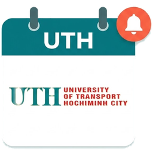
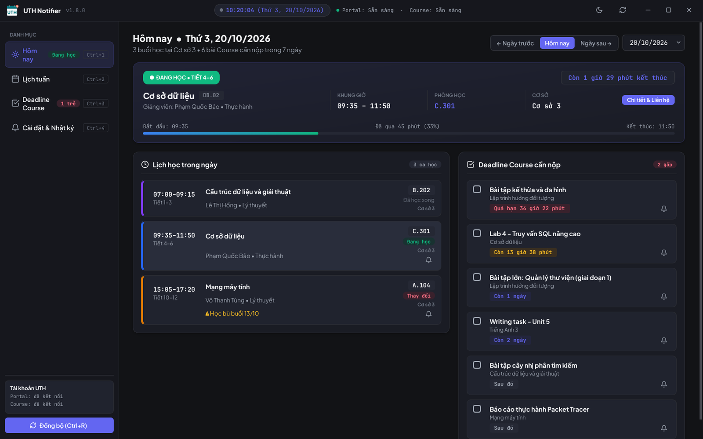
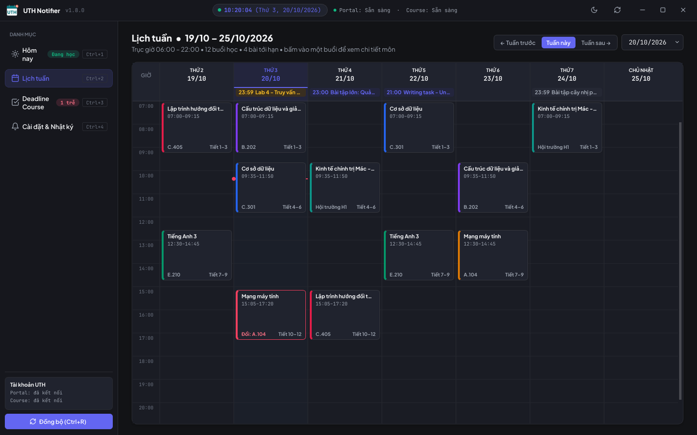
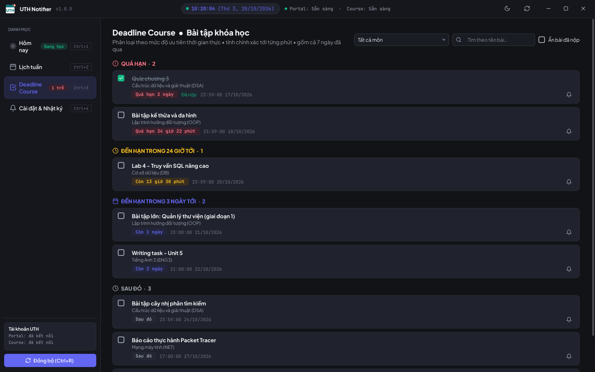
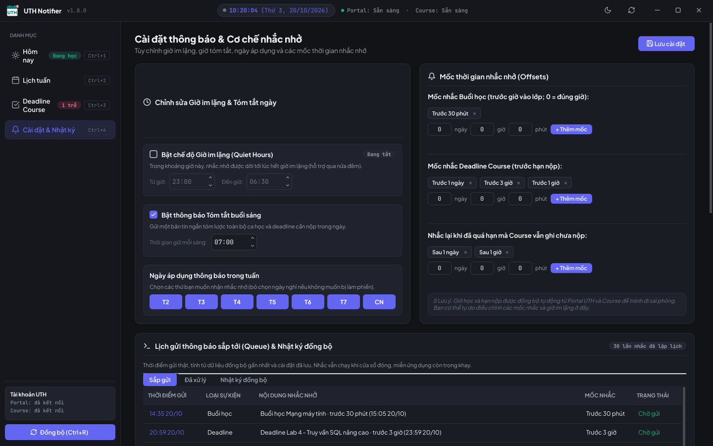

<h1 align="center">UTH Notifier</h1>

Lịch học, deadline và nhắc nhở cho sinh viên UTH, ngay trên máy tính Windows.

  <a href="https://github.com/NguyenToan309/uth-notifier-releases/releases/latest/download/UTH_Notifier.exe"><b>⬇ Tải UTH_Notifier.exe</b></a>
  &nbsp;·&nbsp; Windows 10/11 &nbsp;·&nbsp; Miễn phí &nbsp;·&nbsp; Tự cập nhật

<table>
  <tr>
    <td width="50%"> <b>Hôm nay</b>: buổi đang học, lịch trong ngày, hạn nộp sắp tới</td>
    <td width="50%"> <b>Lịch tuần</b>: cả tuần trên một lưới, buổi đổi lịch viền đỏ</td>
  </tr>
  <tr>
    <td width="50%"> <b>Deadline</b>: quá hạn, 24 giờ tới, 3 ngày tới, tick đã xong</td>
    <td width="50%"> <b>Cài đặt & Nhật ký</b>: giờ im lặng, mốc nhắc, lịch gửi</td>
  </tr>
</table>

Ảnh minh hoạ dùng dữ liệu giả.

## Vì sao nên dùng

Lịch học nằm trên **Portal** (`portal.ut.edu.vn`), bài tập nằm trên **Course** (`courses.ut.edu.vn`), và cả hai đều không tự báo cho bạn khi có gì mới. UTH Notifier gom cả hai vào một nơi, tự cập nhật và nhắc bạn đúng lúc, nên bạn không còn đi nhầm phòng, lỡ buổi học bù hay trễ hạn nộp bài.

## Tính năng chính

| | |
|---|---|
| 📅 **Lịch học** | Xem hôm nay hoặc bất kỳ tuần nào trong học kỳ: giờ, phòng, tiết, giảng viên |
| 📝 **Deadline** | Bài tập trên Course xếp theo mức gấp: quá hạn, hôm nay, 3 ngày tới. Lọc theo môn, ẩn bài đã nộp |
| 🔔 **Nhắc nhở** | Thông báo Windows trước giờ học, trước hạn nộp, khi quá hạn mà chưa nộp, và tóm tắt mỗi sáng |
| ⚠️ **Báo lịch thay đổi** | Báo ngay khi buổi học bị dời, đổi phòng, tạm ngưng hoặc có buổi học bù |
| 👤 **Thông tin lớp** | Giảng viên, số điện thoại, email, nhóm Zalo, tỉ lệ điểm, gọi hoặc nhắn chỉ một cú bấm |
| ⚙️ **Tùy chỉnh** | Tự chọn nhắc trước bao lâu, đặt riêng cho từng môn, giờ im lặng, ngày áp dụng |

App chạy nền dưới khay hệ thống và tự đồng bộ mỗi 20 phút. Khi mất mạng, bạn vẫn xem được dữ liệu đã lưu và vẫn nhận nhắc.

## Bắt đầu trong 3 bước

1. **Tải** [`UTH_Notifier.exe`](https://github.com/NguyenToan309/uth-notifier-releases/releases/latest/download/UTH_Notifier.exe) và đặt trong thư mục cá nhân, ví dụ `Documents` (không đặt trong `Program Files`).
2. **Mở file.** Nếu Windows báo *"Windows protected your PC"*, chọn **More info → Run anyway**.
3. **Đăng nhập** theo banner trong app:
   - **Course**: nhập tài khoản `courses.ut.edu.vn` một lần.
   - **Portal**: app mở cửa sổ Portal, bạn tự đăng nhập và giải CAPTCHA. Khi phiên hết hạn, app sẽ nhắc bạn đăng nhập lại.

Xong. App có sẵn mốc nhắc mặc định: **30 phút** trước giờ học; **1 ngày, 3 giờ, 1 giờ** trước hạn nộp. Bạn đổi được trong *Cài đặt thông báo*.

## An toàn và riêng tư

- Mật khẩu được lưu trong **Windows Credential Manager** trên máy bạn.
- App chỉ kết nối tới Portal, Course và GitHub (để cập nhật). Không có máy chủ riêng, **không thu thập dữ liệu**.
- App **chỉ đọc**: không nộp bài, không sửa gì trên Portal hay Course.
- Bản cập nhật được kiểm tra mã SHA-256 trước khi cài.

## Hỏi đáp nhanh

**Đóng cửa sổ có còn nhận nhắc không?** Có. App vẫn chạy dưới khay hệ thống (góc phải taskbar). Muốn tắt hẳn: chuột phải vào icon → **Thoát**.

**Cập nhật thế nào?** App tự kiểm tra khi mở. Có bản mới thì bấm cập nhật, không phải tải lại.

**Không thấy thông báo?** Tắt chế độ *Focus / Do not disturb* của Windows, kiểm tra giờ im lặng trong app, rồi bấm *Gửi thử thông báo*.

**Gỡ cài đặt?** Thoát app, xoá file `.exe` và thư mục `%APPDATA%\UTH Notifier`, rồi xoá các mục `UTH_Notifier` trong Credential Manager.

---

  Dự án cá nhân, không phải ứng dụng chính thức của nhà trường. 
  Góp ý hoặc báo lỗi tại <a href="https://github.com/NguyenToan309/uth-notifier-releases/issues">Issues</a>.

