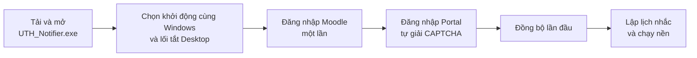
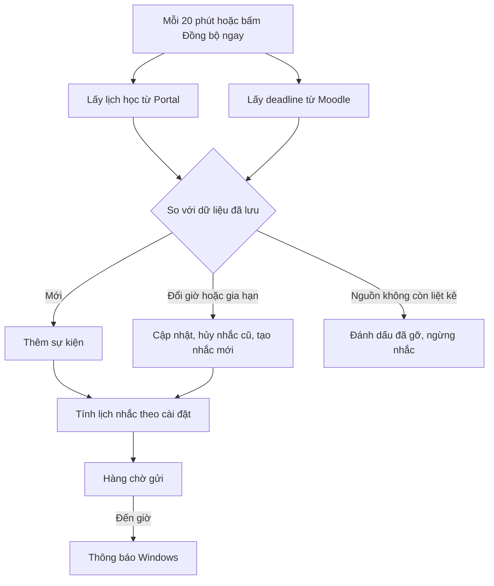

<h1 align="center">UTH Notifier</h1>

<b>Trợ lý lịch học và hạn nộp bài cho sinh viên Trường Đại học Giao thông vận tải TP.HCM (UTH)</b>

  <a href="https://github.com/NguyenToan309/uth-notifier-releases/releases/latest/download/UTH_Notifier.exe"><b>⬇ Tải UTH_Notifier.exe</b></a>
  &nbsp;·&nbsp; Windows 10/11 &nbsp;·&nbsp; Miễn phí &nbsp;·&nbsp; Tự cập nhật

<table>
  <tr>
    <td width="50%"> <b>Hôm nay</b>: buổi đang học, lịch trong ngày, hạn nộp sắp tới</td>
    <td width="50%"> <b>Tuần</b>: cả tuần trên một lưới, buổi đổi lịch tô đỏ</td>
  </tr>
  <tr>
    <td width="50%"> <b>Deadline</b>: nhóm theo mức gấp, trạng thái nộp bài</td>
    <td width="50%"> <b>Cài đặt thông báo</b>: tự quét lịch, mốc nhắc</td>
  </tr>
</table>

Ảnh minh hoạ dùng dữ liệu giả.

---

## Mục lục

1. [Tổng quan](#1-tổng-quan)
2. [Phạm vi sản phẩm](#2-phạm-vi-sản-phẩm)
3. [Nguồn dữ liệu](#3-nguồn-dữ-liệu)
4. [Chức năng theo màn hình](#4-chức-năng-theo-màn-hình)
5. [Quy trình nghiệp vụ](#5-quy-trình-nghiệp-vụ)
6. [Quy tắc nghiệp vụ](#6-quy-tắc-nghiệp-vụ)
7. [Trạng thái và cách hiển thị](#7-trạng-thái-và-cách-hiển-thị)
8. [Cài đặt mặc định](#8-cài-đặt-mặc-định)
9. [Bảo mật và quyền riêng tư](#9-bảo-mật-và-quyền-riêng-tư)
10. [Cài đặt, cập nhật, gỡ bỏ](#10-cài-đặt-cập-nhật-gỡ-bỏ)
11. [Câu hỏi thường gặp](#11-câu-hỏi-thường-gặp)
12. [Giới hạn hiện tại](#12-giới-hạn-hiện-tại)
13. [Thuật ngữ](#13-thuật-ngữ)

---

## 1. Tổng quan

### 1.1. Vấn đề

Sinh viên UTH phải theo dõi hai hệ thống riêng:

- **Portal** (`portal.ut.edu.vn`): lịch học theo tuần, có thể đổi giờ, đổi phòng, tạm ngưng hoặc học bù bất kỳ lúc nào.
- **Moodle** (`courses.ut.edu.vn`): bài tập và hạn nộp của từng môn.

Hai hệ thống này không gửi thông báo chủ động. Sinh viên phải tự đăng nhập để kiểm tra, nên dễ đi nhầm phòng, bỏ lỡ buổi học bù hoặc trễ hạn nộp bài.

### 1.2. Giải pháp

UTH Notifier là ứng dụng chạy nền trên Windows. Ứng dụng gom lịch học và hạn nộp vào một nơi, tự đồng bộ định kỳ và gửi thông báo Windows đúng thời điểm sinh viên cần.

### 1.3. Giá trị mang lại

| Mục tiêu | Cách ứng dụng đáp ứng |
|---|---|
| Không bỏ lỡ buổi học | Nhắc trước giờ học. Báo ngay khi lịch đổi giờ, đổi phòng, tạm ngưng hoặc thêm buổi |
| Không trễ hạn nộp | Nhắc nhiều mốc trước hạn. Nhắc lại khi đã quá hạn mà Moodle vẫn ghi chưa nộp |
| Tiết kiệm thời gian | Một màn hình cho cả lịch học và deadline, không cần đăng nhập hai trang web |
| Chủ động sắp xếp | Xem được mọi tuần trong học kỳ, kể cả tuần đã qua và tuần sắp tới |
| Liên hệ nhanh | Thông tin giảng viên, số điện thoại, nhóm Zalo, tỉ lệ điểm lấy từ trang môn học |

### 1.4. Đối tượng sử dụng

Sinh viên UTH có tài khoản Portal và Moodle, dùng máy tính Windows 10 hoặc 11.

---

## 2. Phạm vi sản phẩm

### 2.1. Trong phạm vi

- Hiển thị lịch học từ Portal và deadline từ Moodle.
- Nhắc nhở bằng thông báo Windows: trước giờ học, trước hạn nộp, sau khi quá hạn và tóm tắt buổi sáng.
- Phát hiện và thông báo thay đổi lịch học.
- Hiển thị thông tin lớp học phần từ trang môn trên Moodle.
- Tùy chỉnh mốc nhắc chung, theo môn và theo từng sự kiện.
- Tự cập nhật phiên bản mới.

### 2.2. Ngoài phạm vi

- Không nộp bài, không đăng ký học phần, không sửa dữ liệu trên Portal hay Moodle. Ứng dụng **chỉ đọc**.
- Không tự vượt CAPTCHA của Portal. Sinh viên tự đăng nhập Portal.
- Không có bản cho điện thoại, macOS hay Linux.
- Không phải ứng dụng chính thức của nhà trường.

---

## 3. Nguồn dữ liệu

| Nguồn | Dữ liệu lấy về | Cách đăng nhập | Tần suất đồng bộ |
|---|---|---|---|
| **Portal** | Buổi học: môn, lớp học phần, giảng viên, phòng, cơ sở, tiết, giờ, ghi chú, trạng thái tạm ngưng | Sinh viên tự đăng nhập trong cửa sổ Portal do ứng dụng mở | Tuần trước, tuần này và tuần sau: mỗi 20 phút. Cả học kỳ: theo chu kỳ quét (mặc định mỗi ngày) |
| **Moodle** | Bài tập, hạn nộp, trạng thái đã nộp; thông tin giảng viên và lớp trên trang môn | Tài khoản Moodle, nhập một lần | Mỗi 20 phút, gồm các bài từ 7 ngày trước trở đi |

Môn học trên Portal và Moodle được **ghép tự động** theo mã và tên môn. Môn nào chưa ghép được sẽ hiện trong mục *Chưa ghép được với Moodle* ở màn Cài đặt thông báo.

---

## 4. Chức năng theo màn hình

### 4.1. Hôm nay

- **Thẻ "Đang học" hoặc "Sắp học"**: môn, giờ, phòng, cơ sở, tiết và thời gian còn lại.
- **Lịch trong ngày**: các buổi học theo giờ. Buổi đã xong làm mờ, buổi đang học tô vàng, buổi bị thay đổi tô đỏ kèm ghi chú.
- **Hạn nộp 7 ngày tới**: các bài sắp đến hạn, kèm thời gian còn lại.

### 4.2. Tuần

- Lưới 7 ngày từ 06:00 đến 22:00. Mỗi môn một màu cố định, có vạch chỉ giờ hiện tại.
- Deadline trong ngày hiện ở đầu cột ngày tương ứng.
- Bấm vào một buổi để mở **bảng chi tiết môn**: thông tin lớp, giảng viên, các buổi trong tuần, deadline sắp tới và mốc nhắc riêng cho môn. Có nút **Gọi**, **Sao chép SĐT**, **Email**, **Zalo** để liên hệ giảng viên, và nút **Sửa** khi thông tin trên Moodle chưa đúng.
- Chuyển tuần bằng mũi tên, nút *Hôm nay* hoặc chọn ngày. Xem được tuần của học kỳ trước và học kỳ sau.

### 4.3. Deadline

- Chia 4 nhóm: **Quá hạn**, **Hôm nay**, **3 ngày tới**, **Sau đó**.
- Lọc theo môn, tìm theo tên bài, ẩn bài đã nộp.
- Nút **Nhắc** trên từng bài: xem các lần nhắc, đặt mốc riêng, đánh dấu *Đã xong*.

### 4.4. Cài đặt thông báo

| Nhóm cài đặt | Ý nghĩa |
|---|---|
| Tự động cập nhật lịch học | Chu kỳ quét toàn học kỳ: 6 giờ, 12 giờ, mỗi ngày, 3 ngày, mỗi tuần hoặc tắt. Có nút *Quét ngay* và danh sách *Thay đổi gần đây* |
| Nhắc buổi học | Các mốc trước giờ học, tính bằng ngày, giờ, phút. 0 nghĩa là đúng giờ |
| Nhắc deadline | Các mốc trước hạn nộp |
| Nhắc lại khi quá hạn | Các mốc sau hạn nộp, khi Moodle vẫn ghi chưa nộp |
| Tóm tắt buổi sáng | Một thông báo tổng hợp lịch học và deadline trong ngày |
| Ngày áp dụng | Chọn các ngày trong tuần được phép gửi nhắc |
| Giờ im lặng | Khoảng giờ không gửi nhắc, có thể qua nửa đêm (ví dụ 23:00–06:30) |
| Cài đặt theo môn | Tắt nhắc hoặc đặt mốc riêng cho từng môn |
| Lịch gửi nhắc | Danh sách sắp gửi, đã xử lý gần đây và nhật ký đồng bộ |
| Hệ thống | Khởi động cùng Windows |

Các nút *Gửi thử thông báo*, *Khôi phục mặc định* và *Lưu cài đặt* nằm cuối màn hình. Nếu rời màn khi còn thay đổi chưa lưu, ứng dụng sẽ hỏi lại.

### 4.5. Khay hệ thống

Đóng cửa sổ thì ứng dụng vẫn chạy dưới khay hệ thống để gửi nhắc. Chuột phải vào biểu tượng để chọn: **Mở**, **Hôm nay có gì**, **Đồng bộ ngay**, **Tạm tắt nhắc 1 giờ**, **Thoát**.

---

## 5. Quy trình nghiệp vụ

### 5.1. Bắt đầu sử dụng

### 5.2. Đồng bộ và lập lịch nhắc

Nếu mất mạng hoặc hết phiên đăng nhập, ứng dụng **giữ nguyên dữ liệu đã đồng bộ** để vẫn xem được và vẫn gửi nhắc. Thanh trạng thái và banner sẽ báo rõ nguồn nào đang lỗi.

### 5.3. Phát hiện thay đổi lịch học

1. Ứng dụng quét Portal từ tuần trước tới hết học kỳ, tối đa 26 tuần, dừng khi gặp 6 tuần trống liên tiếp.
2. Mỗi tuần được so với lần tải trước của chính tuần đó.
3. Các thay đổi được phân loại: **dời buổi** (kèm giờ cũ và giờ mới), **đổi phòng**, **đổi giờ kết thúc**, **tạm ngưng**, **đổi giảng viên**, **đổi ghi chú**, **gỡ buổi**, **thêm buổi**.
4. Ứng dụng gửi thông báo Windows, hiện banner *Lịch học thay đổi* cho tới khi sinh viên bấm *Đã xem*, và ghi vào danh sách *Thay đổi gần đây*.

### 5.4. Gửi nhắc

1. Vòng kiểm tra chạy mỗi 30 giây, kể cả khi cửa sổ đã đóng.
2. Lần nhắc nào đến giờ thì được gửi thành thông báo Windows.
3. Gửi lỗi thì thử lại sau 1 phút, rồi sau 5 phút. Vẫn lỗi thì ghi trạng thái *Lỗi*.
4. Khi máy tắt hoặc ứng dụng tắt rồi mở lại, xem quy tắc BR-09.

### 5.5. Cập nhật phần mềm

Ứng dụng kiểm tra bản mới khi mở và mỗi 6 giờ. Sinh viên cũng có thể bấm *Kiểm tra cập nhật*. Bản mới được tải về, **kiểm tra mã SHA-256**, thay thế file đang dùng rồi khởi động lại. Sinh viên không cần tải lại thủ công.

---

## 6. Quy tắc nghiệp vụ

| Mã | Quy tắc |
|---|---|
| BR-01 | **Thứ tự ưu tiên mốc nhắc**: mốc riêng của sự kiện, rồi mốc theo môn, rồi mốc mặc định theo loại (buổi học, deadline, quá hạn) |
| BR-02 | Mỗi loại nhắc có tối đa 10 mốc. Các mốc không được trùng nhau và không được âm. Mốc 0 nghĩa là đúng giờ |
| BR-03 | Mốc nhắc quá hạn phải lớn hơn 0 và không quá 7 ngày, vì Moodle chỉ liệt kê bài từ 7 ngày trước |
| BR-04 | Lần nhắc rơi vào **giờ im lặng** được dời tới lúc giờ im lặng kết thúc |
| BR-05 | Lần nhắc rơi vào ngày không nằm trong **Ngày áp dụng** sẽ không được gửi |
| BR-06 | Buổi học bị **dời giờ** hoặc deadline được **gia hạn**: hủy các lần nhắc cũ và lập lại theo giờ mới |
| BR-07 | Không nhắc: buổi tạm ngưng, bài đã nộp, sự kiện đã bị gỡ khỏi nguồn, sự kiện sinh viên đánh dấu *Đã xong* hoặc *Bỏ qua*, môn đã tắt nhắc |
| BR-08 | Nhắc quá hạn chỉ gửi khi Moodle vẫn ghi **chưa nộp** |
| BR-09 | **Nhắc trễ** khi mở lại ứng dụng: mỗi sự kiện chỉ gửi lần nhắc mới nhất còn ý nghĩa (buổi học chưa bắt đầu, deadline chưa tới hạn), tối đa 3 lần nhắc trễ mỗi vòng. Các lần còn lại ghi *Bỏ lỡ*, không gửi dồn |
| BR-10 | **Tạm tắt nhắc 1 giờ** từ khay hệ thống chỉ hoãn thông báo, không xóa lịch nhắc |
| BR-11 | Đánh dấu *Đã xong*, *Bỏ qua* và mốc riêng do sinh viên đặt **được giữ nguyên** qua các lần đồng bộ |
| BR-12 | Ứng dụng không xóa lịch sử. Sự kiện nguồn không còn liệt kê chỉ được đánh dấu *đã gỡ* |
| BR-13 | Lần đầu tải một tuần **không** được tính là thay đổi lịch |
| BR-14 | Tuần xem thêm (ngoài tuần trước, tuần này, tuần sau) được tải khi mở, chỉ hỏi lại Portal sau 6 giờ, và được lưu trên máy 400 ngày |
| BR-15 | Hai cửa sổ ứng dụng cùng chạy không gửi trùng một lần nhắc |

---

## 7. Trạng thái và cách hiển thị

### 7.1. Buổi học

| Trạng thái | Hiển thị |
|---|---|
| Đã xong | Chữ mờ, nhãn *Đã xong* |
| Đang học | Nền vàng, nhãn *Đang học* |
| Sắp học | Hiện ở thẻ đầu màn Hôm nay, kèm thời gian còn lại |
| Thay đổi | Nền đỏ, nhãn *Thay đổi* hoặc *Đổi: …*, kèm ghi chú của Portal |
| Tạm ngưng | Portal ghi buổi tạm ngưng: ứng dụng không nhắc buổi này |

### 7.2. Deadline

| Nhóm | Điều kiện |
|---|---|
| Quá hạn | Đã qua hạn nộp |
| Hôm nay | Hạn nộp trong ngày hôm nay |
| 3 ngày tới | Hạn nộp trong 3 ngày kế tiếp |
| Sau đó | Hạn nộp xa hơn |

Mức gấp hiển thị bằng màu nhãn: quá hạn (đỏ), còn dưới 24 giờ (vàng), còn dưới 72 giờ (viền xanh), xa hơn (chữ thường). Trạng thái nộp bài lấy từ Moodle: *Đã nộp* hoặc *Chưa nộp*.

### 7.3. Lần nhắc

| Trạng thái | Ý nghĩa |
|---|---|
| Chờ gửi | Đã lập lịch, chưa tới giờ |
| Đang gửi | Đang gửi thông báo |
| Đã gửi | Đã hiện thông báo |
| Lỗi | Gửi thất bại sau 3 lần thử |
| Bỏ lỡ | Quá giờ khi ứng dụng tắt, không còn ý nghĩa để gửi |
| Đã hủy | Sự kiện đổi giờ, gia hạn hoặc bị gỡ |
| Bỏ qua | Sinh viên đã đánh dấu xong hoặc bỏ qua |

---

## 8. Cài đặt mặc định

| Cài đặt | Mặc định |
|---|---|
| Nhắc buổi học | 30 phút trước |
| Nhắc deadline | 1 ngày, 3 giờ và 1 giờ trước |
| Nhắc lại khi quá hạn | 1 giờ và 1 ngày sau hạn nộp |
| Tóm tắt buổi sáng | 07:00 |
| Ngày áp dụng | Cả tuần (Thứ 2 tới Chủ nhật) |
| Giờ im lặng | Tắt |
| Quét lại lịch cả học kỳ | Mỗi ngày |
| Đồng bộ định kỳ | 20 phút |
| Kiểm tra cập nhật | Khi mở ứng dụng và mỗi 6 giờ |

Bấm *Khôi phục mặc định* để quay về các giá trị trên.

---

## 9. Bảo mật và quyền riêng tư

| Nội dung | Cam kết |
|---|---|
| Mật khẩu và phiên đăng nhập | Lưu trong **Windows Credential Manager** trên máy của sinh viên, không ghi ra file thường |
| CAPTCHA Portal | Do sinh viên tự giải. Ứng dụng không lưu và không gửi CAPTCHA đi đâu |
| Kết nối mạng | Chỉ tới `portal.ut.edu.vn`, `courses.ut.edu.vn` và GitHub (để kiểm tra cập nhật) |
| Thu thập dữ liệu | Không. Ứng dụng không có máy chủ riêng và không gửi dữ liệu cá nhân ra ngoài |
| File nhật ký | Đã che mật khẩu, token, số điện thoại và email. Giới hạn 1 MB × 3 file |
| Bản cập nhật | Kiểm tra mã SHA-256 trước khi thay thế file |

Dữ liệu cục bộ nằm trong `%APPDATA%\UTH Notifier`.

---

## 10. Cài đặt, cập nhật, gỡ bỏ

### 10.1. Yêu cầu

- Windows 10 hoặc Windows 11, 64-bit.
- Kết nối Internet để đồng bộ. Khi không có mạng, ứng dụng vẫn hiển thị dữ liệu đã lưu.
- Tài khoản Portal và Moodle của UTH.

### 10.2. Cài đặt

1. [Tải `UTH_Notifier.exe`](https://github.com/NguyenToan309/uth-notifier-releases/releases/latest/download/UTH_Notifier.exe) và đặt trong thư mục cá nhân (ví dụ `Documents`). **Không** đặt trong `Program Files`, vì ứng dụng cần quyền ghi để tự cập nhật.
2. Mở file. Nếu Windows báo *"Windows protected your PC"*, chọn **More info → Run anyway**.
3. Trả lời các câu hỏi lần đầu: khởi động cùng Windows, tạo lối tắt ngoài Desktop.
4. Bấm **Đăng nhập lại** trên banner để đăng nhập Moodle và Portal.

### 10.3. Cập nhật

Ứng dụng tự cập nhật (xem mục [5.5](#55-cập-nhật-phần-mềm)). Lịch sử phiên bản xem tại [Releases](https://github.com/NguyenToan309/uth-notifier-releases/releases).

### 10.4. Gỡ bỏ

1. Thoát ứng dụng từ khay hệ thống.
2. Tắt *Khởi động cùng Windows* trong Cài đặt (nếu đã bật), rồi xoá file `UTH_Notifier.exe` và lối tắt Desktop.
3. Xoá thư mục `%APPDATA%\UTH Notifier`.
4. Mở **Credential Manager → Windows Credentials**, xoá các mục `UTH_Notifier`.

---

## 11. Câu hỏi thường gặp

**Có cần mở ứng dụng thì mới nhận được nhắc không?**
Không. Đóng cửa sổ thì ứng dụng vẫn chạy dưới khay hệ thống. Nếu bật *Khởi động cùng Windows*, ứng dụng tự chạy khi mở máy.

**Vì sao phải tự đăng nhập Portal?**
Portal dùng CAPTCHA để chống đăng nhập tự động. Ứng dụng tôn trọng cơ chế này nên để sinh viên tự đăng nhập. Phiên đăng nhập có hạn; khi hết hạn, ứng dụng báo để sinh viên đăng nhập lại.

**Không thấy thông báo?**
Kiểm tra theo thứ tự: chế độ **Focus / Do not disturb** của Windows; quyền thông báo của ứng dụng trong *Settings → System → Notifications*; giờ im lặng và ngày áp dụng trong ứng dụng; môn đó có bị tắt nhắc không. Dùng nút *Gửi thử thông báo* để kiểm tra.

**Lịch trong ứng dụng khác Portal?**
Bấm **Đồng bộ ngay** (`Ctrl+R`), hoặc *Quét ngay* trong Cài đặt thông báo để quét toàn học kỳ. Xem nhật ký đồng bộ ở cuối màn Cài đặt thông báo.

**Biểu tượng vẫn là logo cũ sau khi cập nhật?**
Windows còn lưu icon cũ. Khởi động lại máy là hết.

**Báo "Unhandled exception" ngay sau khi cập nhật từ bản 1.2.1 trở về trước?**
Đóng hộp thoại rồi mở lại ứng dụng. Lỗi chỉ xảy ra một lần.

**Phím tắt**

| Phím | Chức năng |
|---|---|
| `Ctrl+1` … `Ctrl+4` | Chuyển giữa Hôm nay, Tuần, Deadline, Cài đặt thông báo |
| `Ctrl+R` | Đồng bộ ngay |
| `←` / `→` | Lùi hoặc tới một ngày (màn Hôm nay) hoặc một tuần (màn Tuần) |
| `Esc` | Đóng bảng chi tiết môn |
| `Ctrl+S` | Lưu cài đặt |

---

## 12. Giới hạn hiện tại

- Portal không cho biết buổi học là lý thuyết, thực hành hay thi, nên chưa có mốc nhắc riêng cho lịch thi.
- Chưa tạo được sự kiện cá nhân (ví dụ lịch họp nhóm) hay sự kiện lặp lại.
- Moodle chỉ trả về các bài từ 7 ngày trước trở đi, nên bài quá hạn lâu hơn không còn hiển thị.
- Thông tin giảng viên và nhóm Zalo phụ thuộc vào cách giảng viên ghi trên trang môn Moodle. Có thể sửa tay trong bảng chi tiết môn.

---

## 13. Thuật ngữ

| Thuật ngữ | Giải thích |
|---|---|
| Portal | Cổng thông tin sinh viên UTH, nơi có lịch học |
| Moodle | Hệ thống học trực tuyến UTH (`courses.ut.edu.vn`), nơi có bài tập và hạn nộp |
| Deadline | Hạn nộp một bài tập trên Moodle |
| Mốc nhắc | Khoảng thời gian trước (hoặc sau) sự kiện mà ứng dụng gửi thông báo, ví dụ "1 ngày 2 giờ" |
| Giờ im lặng | Khoảng giờ ứng dụng không gửi thông báo |
| Đồng bộ | Lấy dữ liệu mới nhất từ Portal và Moodle |
| Quét học kỳ | Đồng bộ toàn bộ các tuần còn lại của học kỳ để phát hiện thay đổi lịch |
| Khay hệ thống | Vùng biểu tượng nhỏ ở góc phải thanh taskbar Windows |

---

  Dự án cá nhân, <b>không phải</b> ứng dụng chính thức của Trường Đại học Giao thông vận tải TP.HCM. 
  Báo lỗi hoặc góp ý tại <a href="https://github.com/NguyenToan309/uth-notifier-releases/issues">Issues</a>.

