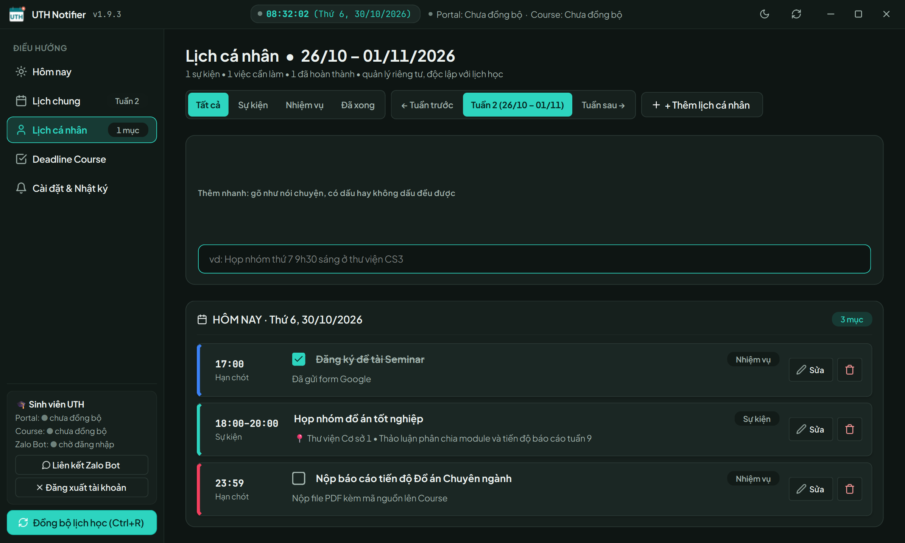

# UTH Notifier

Trợ lý xem lịch học, hạn nộp bài tập và sắp xếp lịch cá nhân dành riêng cho sinh viên Trường Đại học Giao thông vận tải TP.HCM (UTH).


## 🎯 Vì sao cần UTH Notifier?
- Quên phòng học hoặc nhầm lẫn cơ sở di chuyển giữa các ngày học lý thuyết và thực hành.
- Trễ hạn nộp bài tập trên Moodle vì lịch thi và deadline nằm rải rác ở nhiều hệ thống khác nhau.
- Khó sắp xếp và cân bằng giữa lịch học chính khóa với lịch cá nhân như học thêm, làm thêm hay họp nhóm.

## ✨ Tính năng nổi bật

### Trên máy tính Windows
- **Hôm nay:** Buổi học tiếp theo hiển thị nổi bật với giờ, phòng, cơ sở, giảng viên kèm đồng hồ đếm ngược; các ca trong ngày được chia rõ theo buổi Sáng, Chiều, Tối.
- **Lịch chung (Lịch tuần):** Hiển thị lịch học của trường và sự kiện cá nhân trên cùng một bảng; tự động chia đôi cột 50/50 và cảnh báo khi hai lịch diễn ra cùng khung giờ.
- **Màn hình Lịch cá nhân:** Không gian riêng biệt để quản lý lịch hẹn, học nhóm, làm thêm với 4 bộ lọc tiện lợi (Tất cả, Sự kiện, Nhiệm vụ, Đã xong).
- **Deadline và việc cần làm:** Gom bài tập Moodle và việc cá nhân vào chung một bảng phân loại theo mức độ gấp (quá hạn, dưới 24 giờ, trong 3 ngày, sắp tới) kèm nút hoàn tác nếu lỡ thao tác nhầm.
- **Thêm lịch bằng một câu nói:** Nhập câu ngắn có dấu hoặc không dấu (ví dụ: "họp nhóm thứ 5 7h tối ở thư viện"), ứng dụng hiển thị nhãn xem trước thông minh rồi mới lưu.
- **Gợi ý khung giờ trống tránh trùng lịch:** Khi lịch cá nhân trùng với ca học chính quy, ứng dụng tự động phân tích và đề xuất 3 khung giờ trống gần nhất để bạn đổi giờ chỉ bằng một cú nhấp.
- **Báo đổi lịch và nhắc nhở thông minh:** Nhận thông báo tức thì khi trường đổi phòng, dời ca hoặc báo nghỉ; nhắc trước giờ học và trước hạn nộp bài kèm giờ im lặng ban đêm.
- **Xem thông tin môn học:** Tra cứu nhanh số điện thoại, email của giảng viên và đường dẫn tham gia nhóm Zalo lớp học phần ngay trong chi tiết môn.

### Trên Zalo (Trợ lý nhắn tin 1-1)
- **Đăng nhập trực tiếp 3 hệ thống:** Gõ lệnh `/login` kèm mã số sinh viên và mật khẩu để đăng nhập cùng lúc cả 3 trang Portal, Course Moodle và cổng Tin học - Ngoại ngữ (THNN) mà không cần mở trình duyệt web.
- **Bản tin mỗi sáng lúc 06:30:** Tự động gửi tin nhắn tóm tắt lịch học và các hạn nộp trong ngày vào mỗi buổi sáng giúp bạn luôn chủ động thời gian.
- **Thêm lịch bằng tin nhắn:** Nhắn tin tự nhiên trong khung chat riêng để lưu nhanh lịch hẹn hoặc việc cần làm mọi lúc, mọi nơi.
- **Tra cứu lịch tức thì:** Xem nhanh thời khóa biểu hôm nay, lịch cả tuần, danh sách bài tập và lịch cá nhân ngay trên điện thoại.
- **Đồng bộ hai chiều:** Dữ liệu cá nhân được đồng bộ tức thì giữa ứng dụng trên máy tính và trợ lý Zalo.
- **Hỗ trợ hoàn tác:** Dễ dàng khôi phục lại dữ liệu nếu bạn lỡ tay xóa nhầm lịch hoặc bấm nhầm hoàn thành việc bằng lệnh `hoantac`.

## 🖼️ Ảnh chụp màn hình

| Màn hình | Minh họa giao diện thực tế |
|---|---|
| Hôm nay |  |
| Lịch chung (Tuần) |  |
| Lịch cá nhân |  |
| Deadline & Việc cần làm |  |
| Thêm nhanh & Tránh trùng lịch |  |
| Trợ lý Zalo Bot 1-1 |  |

## 🚀 Bắt đầu nhanh
- **Bước 1:** Tải ứng dụng về máy tính từ [LINK TẢI VỀ](https://github.com/NguyenToan309/uth-notifier-releases/releases/latest/download/UTH_Notifier.exe) và mở lên để sử dụng ngay mà không cần cài đặt.
- **Bước 2:** Đăng nhập bằng tài khoản sinh viên UTH của bạn để ứng dụng tự động kết nối và tải về dữ liệu từ cả 3 hệ thống (Portal, Course, THNN).
- **Bước 3 (Tùy chọn):** Kết nối với [TÊN ZALO OA] trên Zalo bằng cách nhắn `/login <MSSV> <Mật khẩu>` để nhận thông báo và nhắc lịch hàng ngày trực tiếp trên điện thoại.

## 💬 Ví dụ câu lệnh trên Zalo
Bạn có thể nhắn tin trực tiếp với Trợ lý Zalo trong khung chat riêng 1-1 bằng các câu lệnh đơn giản sau:

```text
/login 07520600xxxx MatKhau123
/tkb
/tuan
/deadline
/them họp nhóm thứ 5 7h tối ở thư viện
/lichcanhan
/xong 1
/xoa 2
hoantac
/logout
```

## 🔒 Quyền riêng tư & An toàn
- **Không lưu mật khẩu:** Ứng dụng và Trợ lý Zalo chỉ sử dụng thông tin tài khoản của bạn để xác thực với trường rồi hủy ngay, hoàn toàn không lưu trữ mật khẩu sinh viên.
- **Lịch cá nhân nằm trên máy bạn:** Mọi sự kiện và việc cần làm cá nhân mặc định chỉ nằm trên thiết bị của bạn; dữ liệu đồng bộ với Zalo được bảo mật riêng biệt cho từng sinh viên.
- **Toàn quyền xóa sạch dữ liệu:** Bạn có thể đăng xuất và xóa vĩnh viễn toàn bộ dữ liệu của mình bất cứ lúc nào (trên Zalo, chỉ cần gửi tin nhắn `/logout`).

## ❓ Câu hỏi thường gặp

**Ứng dụng có mất phí không?**  
Hoàn toàn miễn phí. UTH Notifier là công cụ hỗ trợ phi lợi nhuận dành riêng cho sinh viên UTH.

**Tôi có cần phải mở web để đăng nhập không?**  
Không cần. Bạn có thể đăng nhập trực tiếp trên Zalo Bot bằng câu lệnh `/login` hoặc đăng nhập ngay trên ứng dụng máy tính một cách nhanh chóng.

**Ứng dụng có dùng được trên điện thoại hoặc máy Mac không?**  
Bản ứng dụng cửa sổ hiện tại dành riêng cho máy tính Windows. Trên điện thoại (Android, iOS) hoặc máy tính Mac, bạn có thể sử dụng đầy đủ các tính năng thông qua Trợ lý Zalo.

**Tôi có thể đổi giờ nhắc lịch ở đâu?**  
Trên máy tính, bạn bấm vào mục Cài đặt để điều chỉnh số phút nhắc trước giờ học hoặc hạn nộp. Trên Zalo, bạn gửi tin nhắn `/setting` để tùy chỉnh thời gian nhắc.

**Nếu thấy dữ liệu lịch học hoặc bài tập chưa đúng thì làm gì?**  
Trên máy tính, bạn bấm nút "Đồng bộ" (hoặc nhấn phím tắt Ctrl+R) để cập nhật dữ liệu mới nhất từ trường. Trên Zalo, bạn chỉ cần gửi tin nhắn `/sync`.

## 📬 Góp ý & Hỗ trợ
Mọi đóng góp ý kiến, phản hồi trải nghiệm hoặc thông báo lỗi, bạn vui lòng liên hệ tại: [LIÊN HỆ](https://github.com/NguyenToan309/uth-notifier-releases/issues)

---
*UTH Notifier là dự án cá nhân của sinh viên, không phải ứng dụng chính thức của Trường ĐH Giao thông vận tải TP.HCM.*
