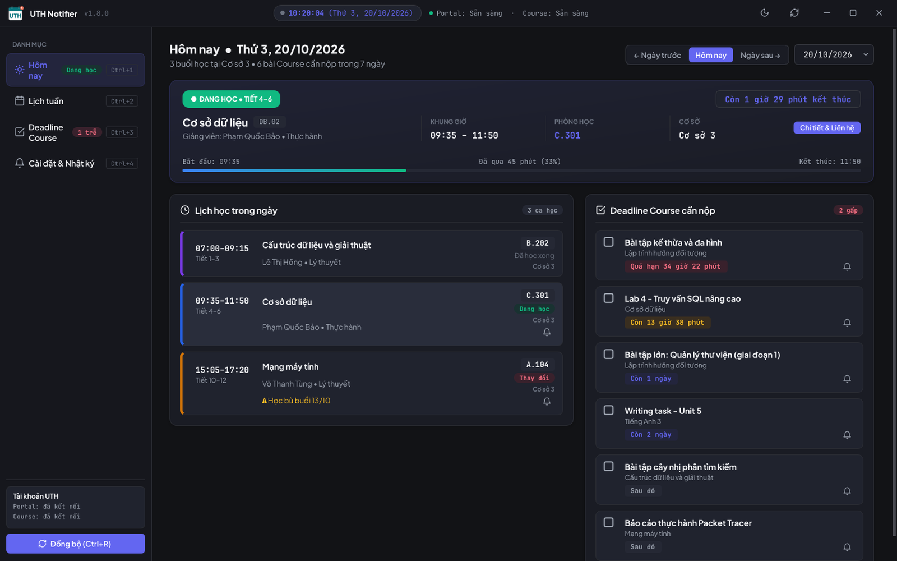
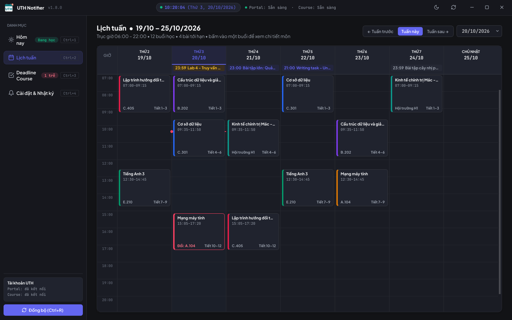
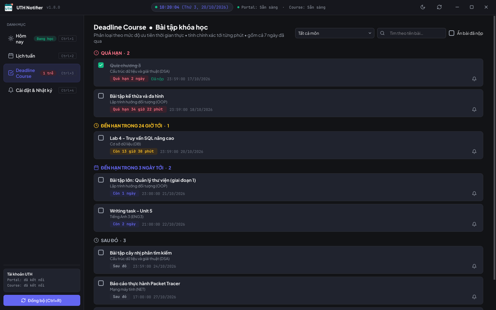
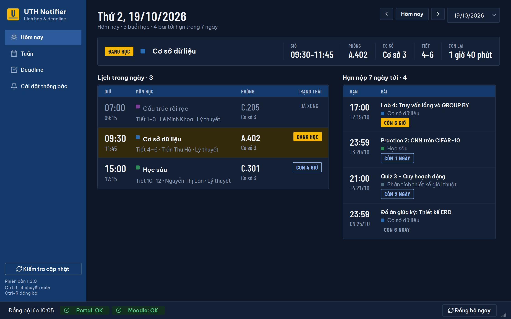
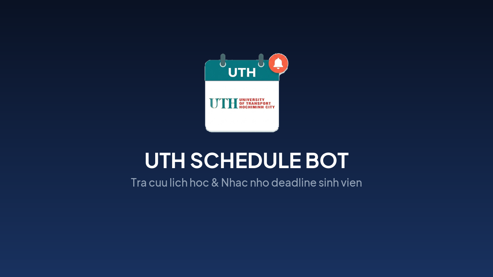

# UTH Notifier

Trợ lý xem lịch học, hạn nộp bài tập và sắp xếp lịch cá nhân dành riêng cho sinh viên Trường Đại học Giao thông vận tải TP.HCM (UTH).




## 🎯 Vì sao cần UTH Notifier?
- Quên phòng học hoặc nhầm lẫn cơ sở di chuyển giữa các ngày học lý thuyết và thực hành.
- Trễ hạn nộp bài tập trên Moodle vì lịch thi và deadline nằm rải rác ở nhiều nơi.
- Khó sắp xếp và cân bằng giữa lịch học của trường với lịch cá nhân như học thêm, làm thêm hay họp nhóm.

## ✨ Tính năng nổi bật

### Trên máy tính Windows
- **Hôm nay:** Buổi học tiếp theo hiển thị rõ giờ, phòng, cơ sở, giảng viên kèm đồng hồ đếm ngược; lịch trong ngày được chia rõ theo buổi Sáng, Chiều, Tối.
- **Lịch tuần:** Hiển thị lịch học và lịch cá nhân trên cùng một bảng, dễ dàng kéo thả để dời lịch cá nhân và tự động báo khi hai lịch trùng giờ nhau.
- **Deadline và việc cần làm:** Gom bài tập trên Moodle và việc cá nhân vào chung một bảng, phân loại theo mức độ gấp (quá hạn, dưới 24 giờ, trong 3 ngày, sắp tới).
- **Thêm lịch bằng một câu nói:** Nhập câu ngắn có dấu hoặc không dấu (ví dụ: "họp nhóm thứ 5 7h tối ở thư viện"), ứng dụng cho bạn xem trước chi tiết rồi mới lưu.
- **Báo đổi lịch tự động:** Nhận thông báo khi trường đổi phòng, báo nghỉ hoặc thêm lịch học bù; ứng dụng tự động gợi ý các khung giờ trống nếu bị trùng lịch cá nhân.
- **Nhắc lịch thông minh:** Nhắc nhở trước giờ vào lớp và trước hạn nộp bài, tích hợp khung giờ im lặng ban đêm để không làm phiền giấc ngủ của bạn.
- **Xem thông tin môn học:** Tra cứu nhanh số điện thoại, email của giảng viên và liên kết tham gia nhóm Zalo lớp học phần ngay trong chi tiết môn.

### Trên Zalo (Chat riêng 1-1)
- **Bản tin mỗi sáng:** Tự động gửi tin nhắn tóm tắt lịch học và các hạn nộp trong ngày vào mỗi buổi sáng giúp bạn chủ động thời gian.
- **Thêm lịch bằng tin nhắn:** Nhắn tin câu lệnh tự nhiên trong khung chat riêng để lưu nhanh lịch hẹn hoặc việc cần làm mọi lúc, mọi nơi.
- **Tra cứu lịch tức thì:** Xem nhanh thời khóa biểu hôm nay, lịch cả tuần, danh sách bài tập và lịch cá nhân ngay trên điện thoại.
- **Hỗ trợ hoàn tác:** Dễ dàng khôi phục lại dữ liệu nếu bạn lỡ tay xóa nhầm lịch hoặc bấm nhầm hoàn thành việc.

## 🖼️ Ảnh chụp màn hình

| Màn hình | Minh họa giao diện |
|---|---|
| Hôm nay |  |
| Lịch tuần |  |
| Deadline & Việc cần làm |  |
| Thêm nhanh lịch |  |
| Trợ lý Zalo |  |

## 🚀 Bắt đầu nhanh
- **Bước 1:** Tải ứng dụng về máy tính từ [LINK TẢI VỀ](https://github.com/NguyenToan309/uth-notifier-releases/releases/latest/download/UTH_Notifier.exe) và mở lên để sử dụng ngay mà không cần cài đặt.
- **Bước 2:** Đăng nhập bằng tài khoản sinh viên UTH của bạn để ứng dụng tự động tải về lịch học và hạn nộp bài tập.
- **Bước 3 (Tùy chọn):** Tìm kiếm [TÊN ZALO OA] trên Zalo và nhắn tin riêng để nhận thông báo nhắc lịch hàng ngày trên điện thoại.

## 💬 Ví dụ câu lệnh trên Zalo
Bạn có thể nhắn tin trực tiếp với Bot trong khung chat 1-1 bằng các câu lệnh đơn giản sau:

```text
/tkb
/tuan
/deadline
/them họp nhóm thứ 5 7h tối ở thư viện
/lichcanhan
```

## 🔒 Quyền riêng tư & An toàn
- **Không lưu mật khẩu:** Ứng dụng chỉ sử dụng thông tin của bạn một lần để xác thực rồi hủy ngay, hoàn toàn không lưu trữ mật khẩu của bạn.
- **Lịch cá nhân nằm trên máy bạn:** Mọi sự kiện và việc cần làm cá nhân mặc định chỉ được lưu trữ an toàn trên chính máy tính của bạn.
- **Toàn quyền xóa dữ liệu:** Bạn có thể xóa sạch toàn bộ dữ liệu của mình bất cứ lúc nào (trên Zalo, chỉ cần gửi tin nhắn `/logout`).

## ❓ Câu hỏi thường gặp

**Ứng dụng có mất phí không?**  
Hoàn toàn miễn phí. UTH Notifier được tạo ra phi lợi nhuận nhằm hỗ trợ các bạn sinh viên UTH học tập thuận tiện hơn.

**Ứng dụng có dùng được trên máy Mac hoặc điện thoại không?**  
Bản ứng dụng máy tính hiện tại dành riêng cho Windows. Trên điện thoại (Android, iPhone) hoặc máy tính Mac, bạn có thể sử dụng đầy đủ các tính năng thông qua trợ lý Zalo.

**Tôi có thể đổi giờ nhắc lịch ở đâu?**  
Trên máy tính, bạn bấm vào mục Cài đặt để điều chỉnh số phút nhắc trước giờ học. Trên Zalo, bạn gửi tin nhắn `/setting` để tùy chỉnh thời gian nhắc theo mong muốn.

**Nếu thấy dữ liệu lịch học hoặc bài tập chưa đúng thì làm gì?**  
Trên máy tính, bạn bấm nút "Đồng bộ" (hoặc nhấn phím tắt Ctrl+R) để cập nhật dữ liệu mới nhất từ trường. Trên Zalo, bạn chỉ cần gửi tin nhắn `/sync`.

## 📬 Góp ý & Hỗ trợ
Mọi đóng góp ý kiến, phản hồi trải nghiệm hoặc thông báo lỗi, bạn vui lòng liên hệ tại: [LIÊN HỆ](https://github.com/NguyenToan309/uth-notifier-releases/issues)

---
*UTH Notifier là dự án cá nhân của sinh viên, không phải ứng dụng chính thức của Trường ĐH Giao thông vận tải TP.HCM.*
